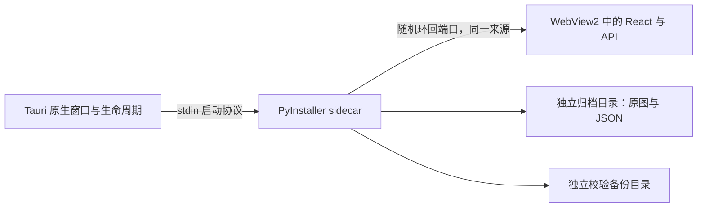

# Windows 桌面架构

桌面版本保留 React、FastAPI 和 [归档格式 1](ARCHIVE_FORMAT.md)，由 Tauri v2 管理窗口与一个 PyInstaller sidecar。Docker 仍可独立运行，两种方式共享数据协议，运行入口各自独立。

## 启动和退出

Tauri 先显示包内加载页面，再启动打包的 `dayframe-server`，通过 stdin 传入每次启动新生成的随机凭据。后端仅绑定 `127.0.0.1` 的系统分配端口，不依赖 8765。完成归档初始化及独占锁定、FastAPI 启动后，stdout 才报告 `DAYFRAME_READY` 和端口；Tauri 再独立检查健康状态。

就绪后，窗口访问一次性 `/desktop/launch` 入口，取得 HttpOnly、SameSite Cookie 并跳转到真实 React 页面。React 静态资源与 API 由同一个本地服务提供，无需放开跨来源访问。Host、Origin 和桌面 Cookie 检查继续生效；普通 Docker 模式不暴露桌面启动或路径设置端点。

Tauri 单实例机制处理重复启动。同一归档的后端独占锁另外防止两个程序同时写入。关闭窗口时，Tauri 关闭/结束 stdin 协议，让后端正常停止并释放归档；Windows Job Object 管理进程树，原生宿主崩溃时也终止其后代。FFmpeg 导出进程处于同一受管进程树中。安装后烟雾验证检查实际退出及重开，实际结果见 [VERIFICATION.md](VERIFICATION.md)。

## 资源和持久目录

NSIS 以当前用户安装应用，默认程序目录为 `%LOCALAPPDATA%\Programs\DayFrame`，并打包 WebView2 离线安装程序。Tauri 使用 `externalBin` 分发 Windows x64 sidecar；sidecar 自带生产前端、FFmpeg 可执行程序及 `licenses/` 分发说明。PyInstaller 会临时解包运行资源；归档、备份和桌面设置不存入该临时目录或程序安装目录。

默认用户根目录为 `%LOCALAPPDATA%\DayFrame`，下有 `Archive`、`Backups`、`Logs`、`Settings`。`DAYFRAME_DATA_HOME` 只为开发和隔离验证提供覆盖入口。设置页中的原生目录选择器返回用户选中的目录；后端检查路径与写入权限，原子保存路径配置，重启后才使用。它不复制或自动迁移任何档案。

原图与 JSON 保持权威，SQLite 是派生索引；导出不覆盖原图，恢复写入新目录。未来信件 JSON 未加密，界面时间锁不构成加密保险箱。

## 安全边界和离线能力

归档管理服务只在 IPv4 环回地址监听，默认没有 LAN 管理入口、通配 CORS、遥测、远程字体、云端图像处理或在线地图。环回监听和每次启动凭据不能抵御已经拥有本机账户权限的恶意软件；本地磁盘仍需用户自己的系统和备份保护。

只有用户主动开启手机临时配对时才启动独立上传监听。手机凭短期会话上传待批准文件，不能浏览管理界面或私人归档。应用不自动设置开机启动或防火墙入站规则。手机 HTTP 未加密，使用范围限可信私有网络。

`DAYFRAME_SMOKE_STATUS` 及测试用 WebView2 调试设置用于隔离安装验证，不是生产 API；普通启动不暴露远程调试。详细威胁边界见 [SECURITY.md](SECURITY.md)，打包和验收步骤见 [WINDOWS_BUILD.md](WINDOWS_BUILD.md)。
